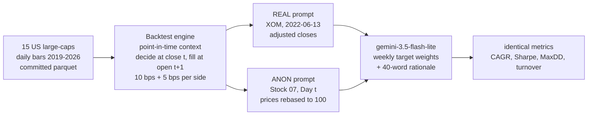
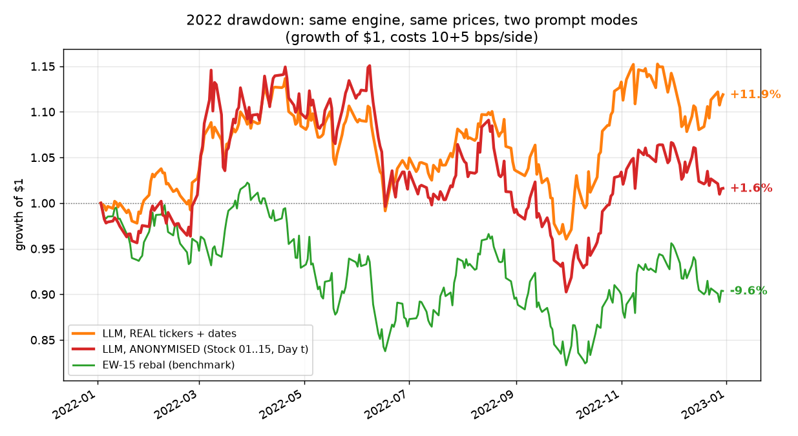
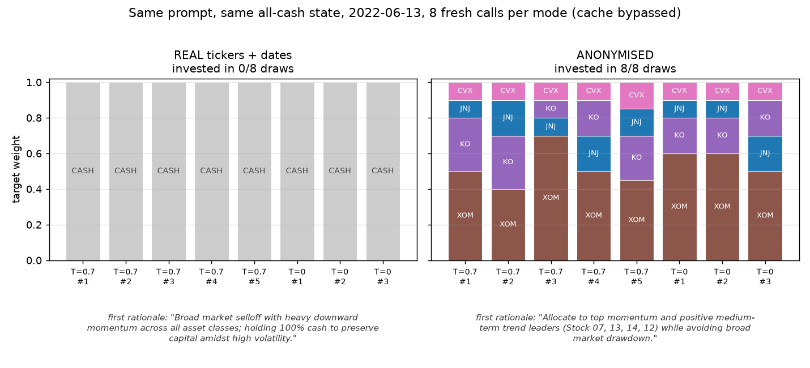
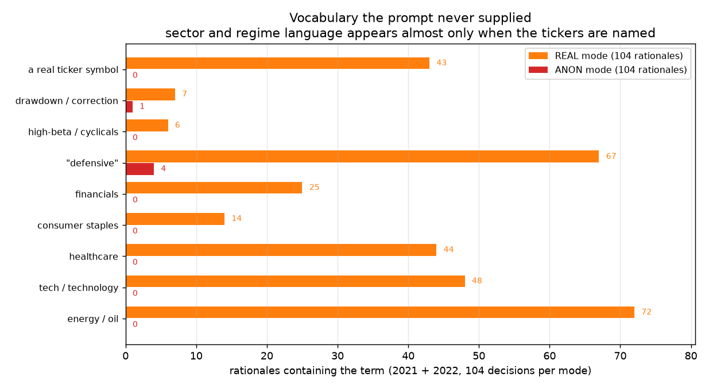
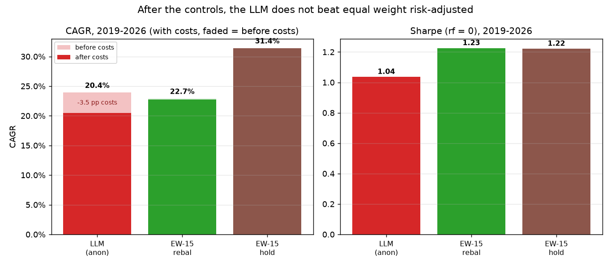

# Can an LLM trade? Only if it can't cheat

Give Gemini real ticker symbols and real dates and it looks like a good discretionary manager: through 2022 it
sidesteps tech, sits in energy, and finishes **+11.9%** while equal-weight buy-and-hold loses **-9.6%**. Hand the
same model the same prices with the labels removed -- `Stock 07`, `Day t`, series rebased to 100 -- and the edge
mostly evaporates. That gap is not evidence of forecasting skill -- it is evidence that the labels matter.

## The experiment

One engine, one price snapshot, one model. The **only** thing that changes between the two arms is whether the
prompt says `XOM, 2022-06-13` or `Stock 07, Day t`.

The prompt holds a 60-bar close table, 1w/1m/3m/6m trailing returns and the current portfolio -- nothing else. No
sector labels, no news, no future bars.

## Evidence 1 — the 2022 gap

Same data, same engine, same seed: **+11.9% real vs +1.6% anonymised**, at half the turnover and with a shallower
drawdown (-15.5% vs -21.6%). The two weight paths correlate at only **0.63-0.64** across (date, ticker) and share
~53% of their held names: not sampling noise, a different strategy.

## Evidence 2 — the same prompt, eight times

Freeze one date (2022-06-13, the Monday of the June selloff), start from all cash, bypass the cache, and call the
model eight times per mode (n=5 at T=0.7, n=3 at T=0):

**Real mode went 100% cash in 8/8 draws.** Verbatim:

> "Broad market selloff with heavy downward momentum across all asset classes; holding 100% cash to preserve capital amidst high volatility."

> "Broad market downtrend with severe momentum deterioration across tech and cyclicals; holding 100% cash to preserve capital and avoid falling knives."

**Anonymised, the same model was fully invested in 8/8 draws**, in the same four names every time (XOM, CVX, JNJ,
KO), with weights moving by 0.1:

> "Allocate to top momentum and positive medium-term trend leaders (Stock 07, 13, 14, 12) while avoiding broad market drawdown."

Sampling noise is small; the prompt mode is what decides whether the agent is invested at all.

## Evidence 3 — vocabulary the prompt never supplied

Counting the model's own rationales (104 decisions per mode, 2021 + 2022):

| term in the rationale | REAL (104 decisions) | ANON (104 decisions) |
|---|---|---|
| energy / oil | 72 | 0 |
| tech / technology | 48 | 0 |
| healthcare | 44 | 0 |
| consumer staples | 14 | 0 |
| financials | 25 | 0 |
| "defensive" | 67 | 4 |
| high-beta / cyclicals | 6 | 0 |
| drawdown / correction | 7 | 1 |
| a real ticker symbol | 43 | 0 |

Sector membership is not in the prompt. It is in the model.

> "Maintain defensive energy and healthcare tilt while trimming underperforming consumer staples. Avoid high-beta tech drawdowns and reduce WMT exposure following recent margin weakness." (2022-05-23)

> "Maintain defensive positioning in energy and healthcare, trim tech momentum amidst ongoing correction, and keep cash buffer steady." (2022-09-06)

## Evidence 4 — the honest bottom line

With the leak controlled, over the full 2019-2026 sample:

| strategy (2019-2026, costs 10+5 bps/side, rf=0) | CAGR | Sharpe | MaxDD | turnover/yr | costs paid | cost drag |
|---|---|---|---|---|---|---|
| LLM, anonymised (weekly) | 20.4% | 1.04 | -25.0% | 9.4x | $605,495 | 3.5 pp/yr |
| EW-15 rebal (benchmark, monthly) | 22.7% | 1.23 | -31.2% | 0.4x | $18,088 | 0.1 pp/yr |
| EW-15 buy & hold | 31.4% | 1.22 | -30.7% | 0.1x | $1,497 | 0.0 pp/yr |

The anonymised agent is a high-turnover momentum chaser. It does **not** beat equal weight risk-adjusted, and it
pays **$605k of costs on $1M** at 9.4x turnover -- 3.5 percentage points a year of CAGR handed to the broker. Its
one good year (2022) is the energy trade that every momentum rule in this repo found.

## Within-family check

*Within-family only (another Gemini release, same tier) -- not a cross-family check.* The 2022 real-vs-anonymised
comparison rerun with `gemini-3.1-flash-lite`, everything else identical (prompt, weekly cadence, T=0, seed 0, 10+5 bps,
52 decisions per mode). Table and word counts: [`reports/within-family.md`](../reports/within-family.md).

| 2022, after costs | real | anon | gap (real - anon) | weight-path corr. |
|---|---|---|---|---|
| gemini-3.5-flash-lite (original) | +11.9% | +1.6% | **+10.3 pp** | 0.65 |
| gemini-3.1-flash-lite (rerun) | +8.2% | -0.8% | **+9.0 pp** | 0.80 |
| EW-15 rebalanced | -9.6% | | | |

**The gap replicates in sign and size** (+9.0 vs +10.3 pp; real beats anon on Sharpe too, 0.49 vs 0.10), and the
sector vocabulary the prompt never supplied shows up only in real mode again (energy/oil 48 vs 0 decisions, tech 28 vs 0,
defensive 48 vs 1, a real ticker symbol 31 vs 0). It is not a perfect copy: this model trades more in both arms (turnover
9.9x real / 13.1x anon), the anonymised arm has a worse drawdown (-28.7%), and the two weight paths correlate more (0.80
vs 0.65). Caveats: one seed, one year, 52 decisions per arm; no repeated-draw consistency check was run on this model
(the 8-draw evidence above is for the original model only); and the second model is a sibling, so shared training data
is the likely common cause -- which is what a leakage story predicts, but also means this is not independent evidence.
The forward test (`reports/forward.md`) and the cross-family run (README, `openai_compat`) are the checks still open.

## Why this matters

- **Any LLM-trading backtest on real symbols and dates is contaminated.** The model has read the period. A
  no-lookahead engine proves nothing here: the leak is in the weights, not in the prompt.
- **Anonymisation plus a no-lookahead engine is the control**, and it is cheap: a seeded ticker shuffle, `Day t`
  labels, prices rebased to 100. Report the anonymised number; treat the real-name number as an upper bound.
- **The negative result after controls is the credible one.** "The LLM lost to equal weight after costs" is a
  result you can defend; "+11.9% in 2022" is a result you cannot.

## Method

Next-open fills (decide at close *t*, fill at open *t+1*, never same-bar); 10 bps commission + 5 bps slippage per
side, every table also reported at zero cost; long-only, integer shares. Lookahead is checked twice: an audit that
formats every post-decision price/date the way the prompt does and asserts none appears, and perturbation tests
that scale all prices after T\* by 1.5 and assert nothing decided before T\* changes. Every (model, prompt,
temperature, seed) -> response is cached on disk and committed, so replaying any number here costs **$0** and
needs no key. 122 offline tests. Model: `gemini-3.5-flash-lite`, Gemini free tier, T=0, seed 0.
Full tables and rationales: [`reports/M4-llm-results.md`](../reports/M4-llm-results.md) (LLM),
[`reports/M3-results.md`](../reports/M3-results.md) (classical baselines),
[`docs/decisions.md`](decisions.md) (#22-#29, the design decisions behind all of it). Figures regenerate with
`.venv/bin/python scripts/fig_leakage.py`.

## Limitations

The 15-name universe was picked in 2026, so every absolute number is inflated by survivorship (EW-hold's 31% CAGR
is mostly NVDA); only same-universe comparisons carry weight. One model, one seed, one market, weekly cadence,
398 decisions -- a few percentage points is noise. rf = 0 throughout. And the evidence is behavioural: it shows
world knowledge changing the decisions, not that the model remembers 2022 price paths.
