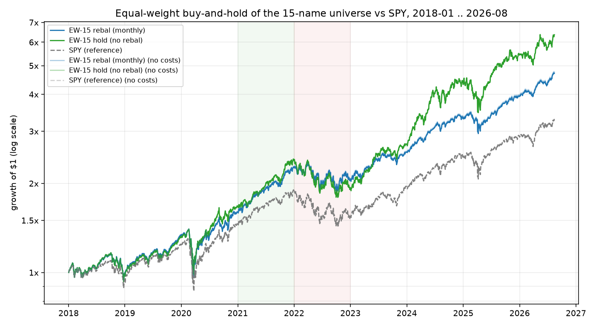

# M2 benchmark: equal-weight buy-and-hold vs SPY

Generated by `scripts/run_benchmark.py` from the committed snapshot (2018-01-02 .. 2026-08-14, 2166 bars). Engine: decisions at close[t], fills at open[t+1], integer shares, no shorting, monthly rebalance (first bar of the month), initial cash $1,000,000. Sharpe/Sortino use **rf = 0**; 252 trading days/year. Costs = 10 bps commission + 5 bps slippage per side. Universe chosen with hindsight (survivorship bias, see decisions.md #2).

## full
### with costs (10+5 bps)

| strategy (rf=0) | CAGR | TotalRet | Vol | Sharpe | Sortino | MaxDD | DD_days | Calmar | Turnover | Exposure | WinRate | Trades | Costs | Costs_bps |
|---|---|---|---|---|---|---|---|---|---|---|---|---|---|---|
| EW-15 rebal (monthly) | 19.8% | 371.4% | 18.1% | 1.09 | 1.55 | -31.2% | 294 | 0.63 | 0.35 | 99.6% | 90.3% | 1550 | 18,707 | 187 |
| EW-15 hold (no rebal) | 24.0% | 535.5% | 22.3% | 1.08 | 1.56 | -29.8% | 356 | 0.80 | 0.06 | 99.9% |  | 15 | 1,497 | 15 |
| SPY (reference) | 14.8% | 228.3% | 19.1% | 0.82 | 1.15 | -33.7% | 488 | 0.44 | 0.06 | 99.9% |  | 1 | 1,498 | 15 |

### no costs

| strategy (rf=0) | CAGR | TotalRet | Vol | Sharpe | Sortino | MaxDD | DD_days | Calmar | Turnover | Exposure | WinRate | Trades | Costs | Costs_bps |
|---|---|---|---|---|---|---|---|---|---|---|---|---|---|---|
| EW-15 rebal (monthly) | 19.9% | 376.0% | 18.1% | 1.10 | 1.56 | -31.2% | 294 | 0.64 | 0.34 | 99.7% | 90.6% | 1549 | 0 | 0 |
| EW-15 hold (no rebal) | 24.0% | 536.4% | 22.3% | 1.08 | 1.56 | -29.8% | 356 | 0.81 | 0.06 | 99.9% |  | 15 | 0 | 0 |
| SPY (reference) | 14.9% | 228.8% | 19.1% | 0.82 | 1.16 | -33.7% | 488 | 0.44 | 0.06 | 100.0% |  | 1 | 0 | 0 |

## 2021 (bull)
### with costs (10+5 bps)

| strategy (rf=0) | CAGR | TotalRet | Vol | Sharpe | Sortino | MaxDD | DD_days | Calmar | Turnover | Exposure | WinRate | Trades | Costs | Costs_bps |
|---|---|---|---|---|---|---|---|---|---|---|---|---|---|---|
| EW-15 rebal (monthly) | 42.3% | 42.1% | 12.1% | 2.97 | 4.54 | -4.1% | 28 | 10.42 | 0.77 | 99.2% | 95.8% | 179 | 2,457 | 25 |
| EW-15 hold (no rebal) | 42.3% | 42.1% | 12.8% | 2.83 | 4.35 | -4.2% | 28 | 10.17 | 0.50 | 99.5% |  | 15 | 1,497 | 15 |
| SPY (reference) | 30.7% | 30.6% | 12.9% | 2.14 | 3.21 | -5.1% | 32 | 6.00 | 0.50 | 99.6% |  | 1 | 1,498 | 15 |

### no costs

| strategy (rf=0) | CAGR | TotalRet | Vol | Sharpe | Sortino | MaxDD | DD_days | Calmar | Turnover | Exposure | WinRate | Trades | Costs | Costs_bps |
|---|---|---|---|---|---|---|---|---|---|---|---|---|---|---|
| EW-15 rebal (monthly) | 42.6% | 42.4% | 12.1% | 2.99 | 4.56 | -4.1% | 28 | 10.48 | 0.77 | 99.3% | 95.8% | 179 | 0 | 0 |
| EW-15 hold (no rebal) | 42.5% | 42.3% | 12.8% | 2.84 | 4.37 | -4.2% | 28 | 10.22 | 0.50 | 99.5% |  | 15 | 0 | 0 |
| SPY (reference) | 30.9% | 30.7% | 12.9% | 2.15 | 3.23 | -5.1% | 32 | 6.04 | 0.50 | 99.6% |  | 1 | 0 | 0 |

## 2022 (drawdown)
### with costs (10+5 bps)

| strategy (rf=0) | CAGR | TotalRet | Vol | Sharpe | Sortino | MaxDD | DD_days | Calmar | Turnover | Exposure | WinRate | Trades | Costs | Costs_bps |
|---|---|---|---|---|---|---|---|---|---|---|---|---|---|---|
| EW-15 rebal (monthly) | -9.7% | -9.6% | 22.1% | -0.35 | -0.49 | -19.6% | 191 | -0.50 | 0.79 | 99.1% | 45.0% | 178 | 2,299 | 23 |
| EW-15 hold (no rebal) | -6.6% | -6.5% | 20.8% | -0.22 | -0.31 | -18.2% | 191 | -0.36 | 0.50 | 99.5% |  | 15 | 1,497 | 15 |
| SPY (reference) | -19.2% | -19.0% | 24.3% | -0.75 | -1.04 | -24.8% | 250 | -0.77 | 0.50 | 99.6% |  | 1 | 1,498 | 15 |

### no costs

| strategy (rf=0) | CAGR | TotalRet | Vol | Sharpe | Sortino | MaxDD | DD_days | Calmar | Turnover | Exposure | WinRate | Trades | Costs | Costs_bps |
|---|---|---|---|---|---|---|---|---|---|---|---|---|---|---|
| EW-15 rebal (monthly) | -9.5% | -9.4% | 22.1% | -0.34 | -0.48 | -19.6% | 191 | -0.49 | 0.79 | 99.2% | 45.6% | 177 | 0 | 0 |
| EW-15 hold (no rebal) | -6.4% | -6.4% | 20.8% | -0.22 | -0.30 | -18.2% | 191 | -0.35 | 0.50 | 99.5% |  | 15 | 0 | 0 |
| SPY (reference) | -19.0% | -18.9% | 24.3% | -0.75 | -1.03 | -24.7% | 250 | -0.77 | 0.50 | 99.6% |  | 1 | 0 | 0 |

## Sanity check: EW-hold vs mean of individual returns

- EW-hold (zero cost) total return: **536.44%**
- Mean of the 15 tickers' total returns (open of first fill bar -> last close): **536.55%**
- Difference: -0.11% (idle cash at end: 0.007% of equity; integer-share rounding at the initial buy leaves a little cash uninvested, and equity starts at cash marked on bar 0 while the buys happen at bar 1's open).
- Per-ticker total returns: NVDA +4368%, AAPL +659%, GOOGL +550%, MSFT +529%, AMZN +342%, JPM +325%, WMT +299%, XOM +175%, BAC +163%, KO +151%, JNJ +136%, CVX +126%, UNH +109%, PG +101%, PFE +16%

## Notes

- Cost drag on EW-rebal (monthly) over the full period: $18,707 paid on $1M initial across 1550 fills; total return 371.4% with costs vs 376.0% without. Costs barely matter for a monthly-rebalanced portfolio; they will matter for anything that trades daily (M3/M4).
- EW-rebal underperforms EW-hold over the full period (19.8% vs 24.0% CAGR): monthly rebalancing keeps trimming the runaway winner (NVDA +4,368%) into laggards. It is the better-behaved benchmark (lower vol, no single-name concentration) and stays the official one; EW-hold is reported alongside.
- `Turnover` counts the initial entry from cash (0.5 one-way), so 1-year runs show >= 0.5 by construction; over the full period it amortises to 0.06/yr for the hold variants.
- Broker cash-scaling events (buys trimmed because a gap-down at the open left less cash than sized at the previous close): 38 of 104 rebalance fills. This is the conservative side of sizing off decision-time equity; the portfolio never borrows.
- Sub-period runs start from cash on the first bar of the period and buy at the second bar's open, so `Exposure` < 100% by one bar and 2021/2022 numbers are for a portfolio *entered* that year, not a slice of the full run.
- EW-hold has no sells, so `WinRate` is undefined (blank). SPY is 100% one ETF and not part of the tradeable universe.
