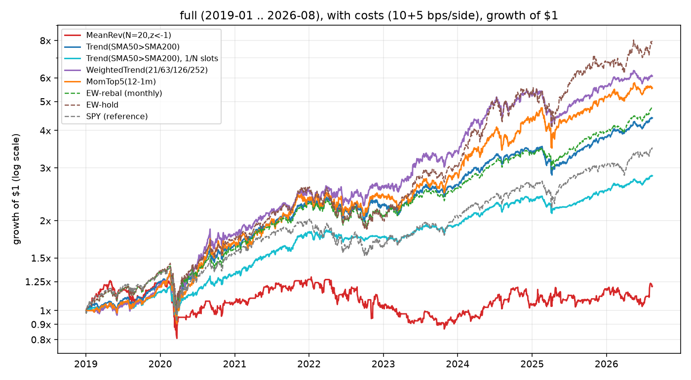
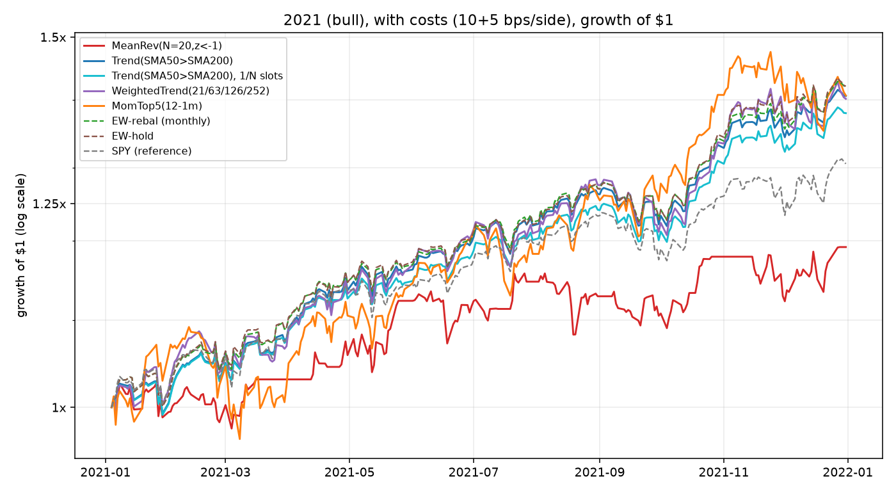
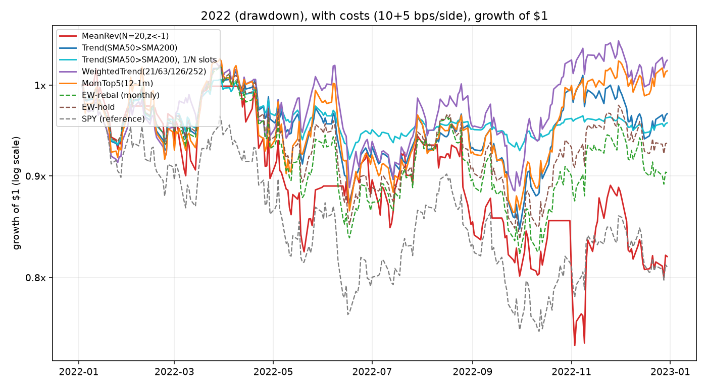
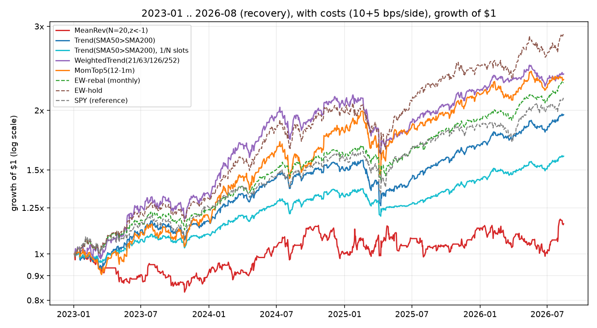

# M3 results: classical strategies vs equal-weight buy-and-hold

Generated by `scripts/run_classical.py` from the committed snapshot (2018-01-02 .. 2026-08-14). Engine: decisions at close[t], fills at open[t+1], integer shares, no shorting/leverage, initial cash $1,000,000. Sharpe/Sortino use **rf = 0**; 252 bars/year. Costs = 10 bps commission + 5 bps slippage per side (30 bps round trip). Universe = 15 US large-caps chosen with hindsight (**survivorship bias**, decisions.md #2); SPY is a reference line, not tradeable.

**Parameter honesty:** every strategy runs on textbook defaults (MeanRev N=20, z<-1; Trend SMA50>SMA200; WeightedTrend = blend of 1/3/6/12-month returns clipped at 0, 25% cap; MomTop5 = 12-1 month, k=5). Nothing was tuned on any reporting period, and no walk-forward tuning was done at all for M3 (decisions.md #19). The results below are therefore *first-run* numbers, not best-of-N.

**Period handling:** each run is entered from cash on the period's first bar and is given its warmup (up to 252 bars) of *pre-period* history so the signal is live from day one; equity is reported from the period's first bar (decisions.md #17/#20). "full" is 2019-01-02 .. 2026-08-14 so every strategy, including the 252-day ones, starts on the same bar (M2's benchmark report keeps 2018).

Rebalance frequencies: MeanRev **weekly**, Trend **weekly**, WeightedTrend **monthly**, MomTop5 **monthly**, EW-rebal monthly. Each run's config (incl. strategy `params`), equity, weights and trades are saved under `reports/runs/<period>/<cost>/<strategy>/`.

## full (2019-01 .. 2026-08)

### with costs (10+5 bps)

| strategy (rf=0) | CAGR | TotalRet | Vol | Sharpe | Sortino | MaxDD | DD_days | Calmar | Turnover | Exposure | WinRate | Trades | Costs | Costs_bps |
|---|---|---|---|---|---|---|---|---|---|---|---|---|---|---|
| MeanRev(N=20,z<-1) | 2.5% | 20.7% | 21.9% | 0.22 | 0.31 | -35.9% | 1150 | 0.07 | 27.53 | 77.3% | 50.0% | 1866 | 684,263 | 6843 |
| Trend(SMA50>SMA200) | 21.6% | 340.3% | 17.9% | 1.18 | 1.70 | -28.3% | 291 | 0.76 | 2.57 | 99.6% | 87.3% | 4250 | 135,699 | 1357 |
| Trend(SMA50>SMA200), 1/N slots | 14.6% | 182.2% | 12.8% | 1.13 | 1.61 | -23.7% | 302 | 0.62 | 1.18 | 70.4% | 89.1% | 4220 | 48,009 | 480 |
| WeightedTrend(21/63/126/252) | 26.8% | 508.0% | 21.6% | 1.21 | 1.76 | -28.6% | 192 | 0.94 | 2.45 | 98.2% | 70.6% | 1121 | 168,788 | 1688 |
| MomTop5(12-1m) | 25.3% | 454.7% | 23.6% | 1.07 | 1.56 | -33.3% | 291 | 0.76 | 2.43 | 98.5% | 83.9% | 536 | 155,346 | 1553 |
| EW-rebal (monthly) | 22.7% | 374.2% | 18.1% | 1.23 | 1.76 | -31.2% | 294 | 0.73 | 0.36 | 99.6% | 93.8% | 1373 | 18,088 | 181 |
| EW-hold | 31.4% | 694.7% | 24.9% | 1.22 | 1.79 | -30.7% | 354 | 1.02 | 0.07 | 99.9% |  | 15 | 1,497 | 15 |
| SPY (reference) | 17.9% | 249.1% | 19.4% | 0.95 | 1.34 | -33.7% | 488 | 0.53 | 0.07 | 99.9% |  | 1 | 1,498 | 15 |

### no costs

| strategy (rf=0) | CAGR | TotalRet | Vol | Sharpe | Sortino | MaxDD | DD_days | Calmar | Turnover | Exposure | WinRate | Trades | Costs | Costs_bps |
|---|---|---|---|---|---|---|---|---|---|---|---|---|---|---|
| MeanRev(N=20,z<-1) | 11.3% | 125.9% | 22.0% | 0.60 | 0.86 | -35.3% | 612 | 0.32 | 27.56 | 77.3% | 51.2% | 1867 | 0 | 0 |
| Trend(SMA50>SMA200) | 22.5% | 367.5% | 17.9% | 1.23 | 1.76 | -28.3% | 285 | 0.79 | 2.56 | 99.7% | 87.7% | 4239 | 0 | 0 |
| Trend(SMA50>SMA200), 1/N slots | 15.1% | 190.3% | 12.8% | 1.16 | 1.65 | -23.7% | 301 | 0.64 | 1.19 | 70.5% | 89.2% | 4226 | 0 | 0 |
| WeightedTrend(21/63/126/252) | 27.8% | 543.7% | 21.6% | 1.24 | 1.82 | -28.6% | 192 | 0.97 | 2.45 | 98.3% | 71.2% | 1122 | 0 | 0 |
| MomTop5(12-1m) | 26.2% | 487.0% | 23.6% | 1.10 | 1.60 | -33.3% | 169 | 0.79 | 2.43 | 98.5% | 84.0% | 535 | 0 | 0 |
| EW-rebal (monthly) | 22.9% | 378.4% | 18.1% | 1.23 | 1.77 | -31.2% | 294 | 0.73 | 0.36 | 99.7% | 94.3% | 1368 | 0 | 0 |
| EW-hold | 31.4% | 695.9% | 24.9% | 1.22 | 1.79 | -30.7% | 354 | 1.02 | 0.07 | 99.9% |  | 15 | 0 | 0 |
| SPY (reference) | 17.9% | 249.6% | 19.4% | 0.95 | 1.35 | -33.7% | 488 | 0.53 | 0.07 | 99.9% |  | 1 | 0 | 0 |

## 2021 (bull)

### with costs (10+5 bps)

| strategy (rf=0) | CAGR | TotalRet | Vol | Sharpe | Sortino | MaxDD | DD_days | Calmar | Turnover | Exposure | WinRate | Trades | Costs | Costs_bps |
|---|---|---|---|---|---|---|---|---|---|---|---|---|---|---|
| MeanRev(N=20,z<-1) | 19.3% | 19.2% | 16.0% | 1.18 | 1.76 | -6.5% | 60 | 2.97 | 26.40 | 74.4% | 53.8% | 238 | 86,601 | 866 |
| Trend(SMA50>SMA200) | 40.8% | 40.6% | 12.5% | 2.81 | 4.29 | -4.1% | 28 | 9.97 | 1.61 | 99.3% | 90.5% | 728 | 5,396 | 54 |
| Trend(SMA50>SMA200), 1/N slots | 38.2% | 38.0% | 11.9% | 2.79 | 4.25 | -4.1% | 28 | 9.32 | 1.36 | 93.8% | 90.9% | 725 | 4,500 | 45 |
| WeightedTrend(21/63/126/252) | 40.4% | 40.2% | 16.1% | 2.18 | 3.39 | -5.9% | 35 | 6.81 | 2.13 | 99.2% | 77.9% | 175 | 7,379 | 74 |
| MomTop5(12-1m) | 40.9% | 40.7% | 21.2% | 1.72 | 2.61 | -11.5% | 39 | 3.54 | 1.96 | 99.3% | 96.3% | 66 | 6,533 | 65 |
| EW-rebal (monthly) | 42.3% | 42.1% | 12.1% | 2.97 | 4.54 | -4.1% | 28 | 10.42 | 0.77 | 99.2% | 95.8% | 179 | 2,457 | 25 |
| EW-hold | 42.3% | 42.1% | 12.8% | 2.83 | 4.35 | -4.2% | 28 | 10.17 | 0.50 | 99.5% |  | 15 | 1,497 | 15 |
| SPY (reference) | 30.7% | 30.6% | 12.9% | 2.14 | 3.21 | -5.1% | 32 | 6.00 | 0.50 | 99.6% |  | 1 | 1,498 | 15 |

### no costs

| strategy (rf=0) | CAGR | TotalRet | Vol | Sharpe | Sortino | MaxDD | DD_days | Calmar | Turnover | Exposure | WinRate | Trades | Costs | Costs_bps |
|---|---|---|---|---|---|---|---|---|---|---|---|---|---|---|
| MeanRev(N=20,z<-1) | 29.1% | 29.0% | 16.1% | 1.67 | 2.55 | -6.1% | 51 | 4.81 | 26.42 | 74.4% | 54.2% | 237 | 0 | 0 |
| Trend(SMA50>SMA200) | 41.5% | 41.4% | 12.5% | 2.85 | 4.36 | -4.1% | 28 | 10.17 | 1.60 | 99.4% | 90.9% | 725 | 0 | 0 |
| Trend(SMA50>SMA200), 1/N slots | 38.8% | 38.6% | 11.9% | 2.82 | 4.31 | -4.1% | 28 | 9.50 | 1.36 | 93.9% | 90.6% | 728 | 0 | 0 |
| WeightedTrend(21/63/126/252) | 41.3% | 41.1% | 16.1% | 2.22 | 3.45 | -5.8% | 35 | 7.09 | 2.14 | 99.3% | 77.9% | 176 | 0 | 0 |
| MomTop5(12-1m) | 41.7% | 41.5% | 21.2% | 1.75 | 2.65 | -11.5% | 38 | 3.63 | 1.96 | 99.3% | 96.3% | 66 | 0 | 0 |
| EW-rebal (monthly) | 42.6% | 42.4% | 12.1% | 2.99 | 4.56 | -4.1% | 28 | 10.48 | 0.77 | 99.3% | 95.8% | 179 | 0 | 0 |
| EW-hold | 42.5% | 42.3% | 12.8% | 2.84 | 4.37 | -4.2% | 28 | 10.22 | 0.50 | 99.5% |  | 15 | 0 | 0 |
| SPY (reference) | 30.9% | 30.7% | 12.9% | 2.15 | 3.23 | -5.1% | 32 | 6.04 | 0.50 | 99.6% |  | 1 | 0 | 0 |

## 2022 (drawdown)

### with costs (10+5 bps)

| strategy (rf=0) | CAGR | TotalRet | Vol | Sharpe | Sortino | MaxDD | DD_days | Calmar | Turnover | Exposure | WinRate | Trades | Costs | Costs_bps |
|---|---|---|---|---|---|---|---|---|---|---|---|---|---|---|
| MeanRev(N=20,z<-1) | -18.2% | -18.0% | 28.4% | -0.56 | -0.79 | -27.4% | 243 | -0.66 | 23.42 | 75.7% | 35.2% | 344 | 62,415 | 624 |
| Trend(SMA50>SMA200) | -3.3% | -3.3% | 19.3% | -0.08 | -0.11 | -17.1% | 191 | -0.19 | 3.63 | 99.1% | 59.2% | 402 | 10,315 | 103 |
| Trend(SMA50>SMA200), 1/N slots | -4.3% | -4.3% | 10.3% | -0.38 | -0.52 | -8.8% | 191 | -0.49 | 1.52 | 50.6% | 61.6% | 405 | 4,408 | 44 |
| WeightedTrend(21/63/126/252) | 3.0% | 2.9% | 20.9% | 0.24 | 0.34 | -14.2% | 155 | 0.21 | 2.69 | 97.1% | 38.7% | 125 | 7,909 | 79 |
| MomTop5(12-1m) | 1.7% | 1.7% | 23.5% | 0.19 | 0.26 | -16.3% | 191 | 0.10 | 2.54 | 99.0% | 55.9% | 69 | 7,398 | 74 |
| EW-rebal (monthly) | -9.7% | -9.6% | 22.1% | -0.35 | -0.49 | -19.6% | 191 | -0.50 | 0.79 | 99.1% | 45.0% | 178 | 2,299 | 23 |
| EW-hold | -6.6% | -6.5% | 20.8% | -0.22 | -0.31 | -18.2% | 191 | -0.36 | 0.50 | 99.5% |  | 15 | 1,497 | 15 |
| SPY (reference) | -19.2% | -19.0% | 24.3% | -0.75 | -1.04 | -24.8% | 250 | -0.77 | 0.50 | 99.6% |  | 1 | 1,498 | 15 |

### no costs

| strategy (rf=0) | CAGR | TotalRet | Vol | Sharpe | Sortino | MaxDD | DD_days | Calmar | Turnover | Exposure | WinRate | Trades | Costs | Costs_bps |
|---|---|---|---|---|---|---|---|---|---|---|---|---|---|---|
| MeanRev(N=20,z<-1) | -12.2% | -12.1% | 28.3% | -0.32 | -0.45 | -23.3% | 243 | -0.52 | 23.44 | 75.7% | 35.2% | 344 | 0 | 0 |
| Trend(SMA50>SMA200) | -2.2% | -2.2% | 19.3% | -0.02 | -0.03 | -16.8% | 191 | -0.13 | 3.63 | 99.2% | 59.9% | 404 | 0 | 0 |
| Trend(SMA50>SMA200), 1/N slots | -3.9% | -3.9% | 10.3% | -0.34 | -0.46 | -8.8% | 191 | -0.44 | 1.51 | 50.7% | 61.4% | 400 | 0 | 0 |
| WeightedTrend(21/63/126/252) | 3.8% | 3.8% | 20.9% | 0.28 | 0.39 | -13.9% | 150 | 0.27 | 2.69 | 97.2% | 38.7% | 125 | 0 | 0 |
| MomTop5(12-1m) | 2.5% | 2.4% | 23.6% | 0.22 | 0.30 | -16.1% | 169 | 0.15 | 2.54 | 99.1% | 55.9% | 69 | 0 | 0 |
| EW-rebal (monthly) | -9.5% | -9.4% | 22.1% | -0.34 | -0.48 | -19.6% | 191 | -0.49 | 0.79 | 99.2% | 45.6% | 177 | 0 | 0 |
| EW-hold | -6.4% | -6.4% | 20.8% | -0.22 | -0.30 | -18.2% | 191 | -0.35 | 0.50 | 99.5% |  | 15 | 0 | 0 |
| SPY (reference) | -19.0% | -18.9% | 24.3% | -0.75 | -1.03 | -24.7% | 250 | -0.77 | 0.50 | 99.6% |  | 1 | 0 | 0 |

## 2023-01 .. 2026-08 (recovery)

### with costs (10+5 bps)

| strategy (rf=0) | CAGR | TotalRet | Vol | Sharpe | Sortino | MaxDD | DD_days | Calmar | Turnover | Exposure | WinRate | Trades | Costs | Costs_bps |
|---|---|---|---|---|---|---|---|---|---|---|---|---|---|---|
| MeanRev(N=20,z<-1) | 4.1% | 15.7% | 18.9% | 0.31 | 0.43 | -17.4% | 443 | 0.24 | 29.68 | 83.9% | 54.3% | 854 | 325,251 | 3253 |
| Trend(SMA50>SMA200) | 20.5% | 95.8% | 12.9% | 1.51 | 2.20 | -19.8% | 146 | 1.04 | 2.70 | 99.6% | 85.9% | 2038 | 39,933 | 399 |
| Trend(SMA50>SMA200), 1/N slots | 14.0% | 60.3% | 9.0% | 1.50 | 2.17 | -12.4% | 171 | 1.13 | 1.31 | 71.7% | 87.7% | 2019 | 17,655 | 177 |
| WeightedTrend(21/63/126/252) | 27.3% | 138.3% | 17.8% | 1.44 | 2.19 | -24.8% | 192 | 1.10 | 2.61 | 99.6% | 66.7% | 544 | 48,717 | 487 |
| MomTop5(12-1m) | 26.4% | 132.1% | 19.7% | 1.29 | 1.94 | -26.7% | 165 | 0.99 | 2.80 | 99.6% | 82.1% | 264 | 48,834 | 488 |
| EW-rebal (monthly) | 25.9% | 128.8% | 12.1% | 1.97 | 2.99 | -15.2% | 105 | 1.70 | 0.45 | 99.6% | 87.0% | 652 | 6,732 | 67 |
| EW-hold | 34.2% | 188.2% | 18.3% | 1.70 | 2.58 | -21.7% | 105 | 1.58 | 0.14 | 99.8% |  | 15 | 1,497 | 15 |
| SPY (reference) | 23.2% | 111.6% | 15.1% | 1.46 | 2.19 | -18.8% | 87 | 1.24 | 0.14 | 99.9% |  | 1 | 1,498 | 15 |

### no costs

| strategy (rf=0) | CAGR | TotalRet | Vol | Sharpe | Sortino | MaxDD | DD_days | Calmar | Turnover | Exposure | WinRate | Trades | Costs | Costs_bps |
|---|---|---|---|---|---|---|---|---|---|---|---|---|---|---|
| MeanRev(N=20,z<-1) | 13.8% | 59.3% | 18.9% | 0.78 | 1.12 | -13.3% | 246 | 1.04 | 29.70 | 83.9% | 56.6% | 855 | 0 | 0 |
| Trend(SMA50>SMA200) | 21.5% | 101.6% | 12.9% | 1.57 | 2.29 | -19.7% | 142 | 1.10 | 2.69 | 99.7% | 86.5% | 2034 | 0 | 0 |
| Trend(SMA50>SMA200), 1/N slots | 14.5% | 62.6% | 9.0% | 1.55 | 2.24 | -12.4% | 167 | 1.17 | 1.31 | 71.8% | 88.0% | 2013 | 0 | 0 |
| WeightedTrend(21/63/126/252) | 28.4% | 145.3% | 17.8% | 1.49 | 2.27 | -24.7% | 192 | 1.15 | 2.61 | 99.6% | 66.9% | 544 | 0 | 0 |
| MomTop5(12-1m) | 27.5% | 139.4% | 19.7% | 1.33 | 2.01 | -26.5% | 154 | 1.04 | 2.80 | 99.7% | 81.8% | 264 | 0 | 0 |
| EW-rebal (monthly) | 26.1% | 129.9% | 12.1% | 1.98 | 3.01 | -15.2% | 105 | 1.71 | 0.44 | 99.7% | 88.2% | 650 | 0 | 0 |
| EW-hold | 34.3% | 188.6% | 18.3% | 1.70 | 2.58 | -21.7% | 105 | 1.58 | 0.14 | 99.8% |  | 15 | 0 | 0 |
| SPY (reference) | 23.2% | 111.9% | 15.1% | 1.46 | 2.20 | -18.8% | 87 | 1.24 | 0.14 | 99.9% |  | 1 | 0 | 0 |

## Cost sensitivity (full period CAGR vs round-trip cost)

Same runs, costs swept at 0 / 15 / 30 / 60 bps round trip (commission:slippage 2:1 per side). Turnover is annualised one-way (sum |fill notional| / equity / 2).

| CAGR at round-trip cost | 0 bps | 15 bps | 30 bps | 60 bps | turnover/yr |
|---|---|---|---|---|---|
| MeanRev(N=20,z<-1) | 11.3% | 6.8% | 2.5% | -5.6% | 27.51 |
| Trend(SMA50>SMA200) | 22.5% | 22.0% | 21.6% | 20.6% | 2.58 |
| Trend(SMA50>SMA200), 1/N slots | 15.1% | 14.8% | 14.6% | 14.2% | 1.18 |
| WeightedTrend(21/63/126/252) | 27.8% | 27.3% | 26.8% | 25.9% | 2.45 |
| MomTop5(12-1m) | 26.2% | 25.8% | 25.3% | 24.4% | 2.43 |
| EW-rebal (monthly) | 22.9% | 22.8% | 22.7% | 22.6% | 0.36 |
| EW-hold | 31.4% | 31.4% | 31.4% | 31.4% | 0.07 |

## Interpretation (honest version)

- **Full period (2019-2026), after costs:** the two momentum-weighted strategies beat the official benchmark on CAGR -- WeightedTrend 26.8% and MomTop5 25.3% vs EW-rebal 22.7% -- but with more volatility (21.6% / 23.6% vs 18.1%), so their Sharpe (1.21 / 1.07) is no better than EW-rebal's 1.23, and both trail EW-hold (31.4%, Sharpe 1.22). Their edge over EW-rebal is the same thing EW-hold's is: holding more of the names we already know became giants. Read as "no risk-adjusted alpha from classical rules on this universe", not "momentum works".
- **Trend-following (SMA50>SMA200) is a sizing story.** Equal-weighting the trending names keeps the book ~100% invested whenever anything trends and returned 21.6% (Sharpe 1.18), i.e. EW-rebal with extra turnover. The 1/N-slot version -- each name long or cash -- is the real trend *filter*: 14.6% CAGR at 70.4% average exposure, vol 12.8%, MaxDD -23.7% (EW-rebal -31.2%), Sharpe 1.13. Same risk-adjusted return, a third less drawdown, a lot less absolute return. On this sample the trend filter bought insurance, not alpha.
- **2022 drawdown, after costs:** EW-rebal -9.7%, SPY -19.2%. WeightedTrend 3.0% and MomTop5 1.7% finished *positive*: both rotated into the energy names (XOM/CVX) that trended up all year, while staying ~fully invested. Trend-equal -3.3% at 99.1% exposure did the same rotation, less cleanly; Trend-slots -4.3% at 50.6% exposure, vol 10.3%, MaxDD -8.8% is what de-risking looks like. MeanRev -18.2% bought every dip in a year when dips kept dipping -- the worst line in the table.
- **2021 bull, after costs:** EW-rebal 42.3% and nothing beat it; Trend 40.8%, MomTop5 40.9% and WeightedTrend 40.4% were within a couple of points, MeanRev 19.3% (29.1% before costs). In a broad melt-up any rule that is not always fully invested, or that trades a lot, pays for it.
- **2023-2026 recovery, after costs:** EW-rebal 25.9% (Sharpe 1.97); WeightedTrend 27.3% and MomTop5 26.4% edged it on CAGR with much worse Sharpe (1.44 / 1.29) and drawdown (-24.8% / -26.7% vs -15.2%) -- concentrated bets on NVDA-led tech.
- **Costs are the whole story for the fast strategy.** MeanRev turns over 28x/yr and its full-period CAGR goes 11.3% -> 6.8% -> 2.5% -> -5.6% at 0 / 15 / 30 / 60 bps round trip ($684,263 of costs on $1M). The weekly trend rules turn over 2.6x / 1.2x per year and lose ~1-2 CAGR points between 0 and 60 bps (22.5% -> 20.6%); the monthly ones (WeightedTrend 27.8% -> 25.9%, MomTop5 26.2% -> 24.4%) and EW-rebal (22.9% -> 22.6%) barely notice.
- **Mean reversion, as specified, does not work here even for free** (11.3% CAGR at zero cost vs 22.9% for EW-rebal, at 77.3% average exposure): a 20-day z-score on daily large-cap closes spends bull years buying whatever lagged and bear years catching falling knives. It stays in the table unchanged -- tuning N or the threshold on these years would be exactly the in-sample fitting decisions.md #19 forbids.
- **Caveat -- survivorship:** all 15 names were picked in 2026 knowing they survived and (mostly) grew. Every absolute number here -- and especially the momentum strategies' edge, which comes from riding names we already know became giants -- is inflated relative to a point-in-time 2018 universe. Only the *relative* ordering under identical rules is meaningful, and even that favours long-only, always-invested rules on this sample.
- Sub-period Turnover includes the initial entry from cash (0.5 one-way), as in M2. Broker cash-scaling and sell-capping counts are in each run's `config.json`.
