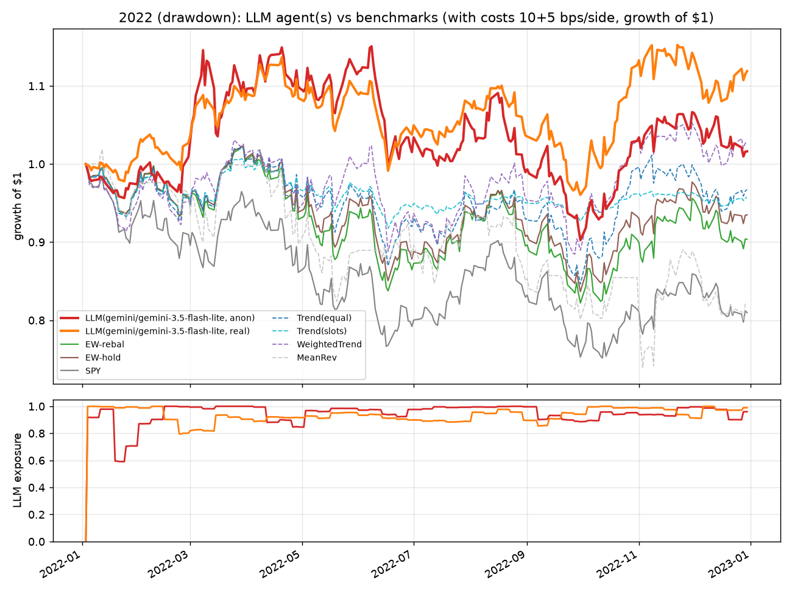
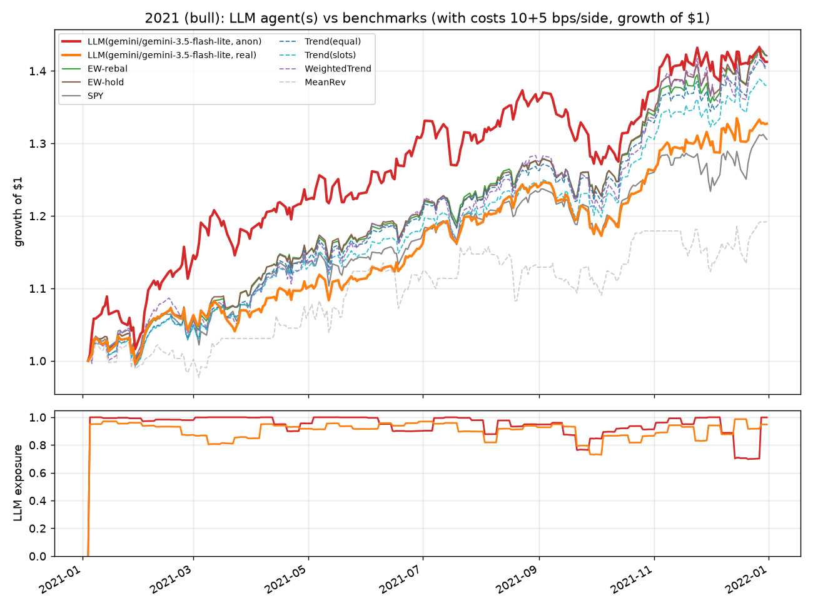

# M4 results: LLM agent (Gemini) vs classical strategies and buy-and-hold

Generated by `scripts/report_llm.py` from the saved runs under `reports/runs/llm/` (no model calls). Agent: `LLMAgent` (decisions.md #22-#25) on **gemini-3.5-flash-lite** (Gemini API free tier, REST, thinking `minimal`, temperature 0, seed 0, `max_tokens` 400), weekly decisions at the close with fills at the next open, 60-bar price window + 1w/1m/3m/6m trailing returns + portfolio state in the prompt, long-only, sum of weights <= 1. Two prompt modes: **anon** (tickers -> `Stock 01..15` via a seeded shuffle, dates -> `Day t`, prices rebased to 100) and **real** (symbols, calendar dates, adjusted closes). Same engine, costs (10 bps commission + 5 bps slippage per side), period handling (entered from cash on the period's first bar with pre-period warmup history) and benchmarks as `reports/M3-results.md`; rf = 0. Every prompt/response pair is in `data/llm_cache/` (committed), so the tables replay with zero API calls. Model choice and quota handling: decisions.md #27-#28 (the planned `gemini-2.5-flash` is gone for new users; the flash models are capped at 20 requests/day on the free tier, flash-lite at 500).

## 2022 (drawdown)

Top: growth of $1 with costs (LLM agents bold; `[no costs]` rows in the table replay the same logged weights at zero cost). Bottom: LLM target exposure (sum of weights) over time.

### Metrics (costs 10+5 bps/side unless marked, rf = 0)

| strategy (rf=0) | CAGR | TotalRet | Vol | Sharpe | Sortino | MaxDD | DD_days | Calmar | Turnover | Exposure | WinRate | Trades | Costs | Costs_bps |
|---|---|---|---|---|---|---|---|---|---|---|---|---|---|---|
| LLM(gemini/gemini-3.5-flash-lite, anon) | 1.6% | 1.6% | 22.7% | 0.18 | 0.26 | -21.6% | 142 | 0.08 | 8.60 | 94.3% | 47.9% | 317 | 26,254 | 263 |
| LLM(gemini/gemini-3.5-flash-lite, anon) [no costs] | 4.3% | 4.3% | 22.7% | 0.30 | 0.42 | -20.8% | 142 | 0.21 | 8.61 | 94.4% | 48.6% | 317 | 0 | 0 |
| LLM(gemini/gemini-3.5-flash-lite, real) | 12.0% | 11.9% | 18.6% | 0.70 | 0.99 | -15.5% | 138 | 0.77 | 4.47 | 93.3% | 57.7% | 405 | 13,706 | 137 |
| LLM(gemini/gemini-3.5-flash-lite, real) [no costs] | 13.5% | 13.4% | 18.6% | 0.77 | 1.10 | -15.0% | 134 | 0.90 | 4.48 | 93.5% | 57.9% | 407 | 0 | 0 |
| EW-rebal (monthly) | -9.7% | -9.6% | 22.1% | -0.35 | -0.49 | -19.6% | 191 | -0.50 | 0.79 | 99.1% | 45.0% | 178 | 2,299 | 23 |
| EW-hold | -6.6% | -6.5% | 20.8% | -0.22 | -0.31 | -18.2% | 191 | -0.36 | 0.50 | 99.5% |  | 15 | 1,497 | 15 |
| SPY (reference) | -19.2% | -19.0% | 24.3% | -0.75 | -1.04 | -24.8% | 250 | -0.77 | 0.50 | 99.6% |  | 1 | 1,498 | 15 |
| Trend(SMA50>SMA200) | -3.3% | -3.3% | 19.3% | -0.08 | -0.11 | -17.1% | 191 | -0.19 | 3.63 | 99.1% | 59.2% | 402 | 10,315 | 103 |
| Trend(SMA50>SMA200), 1/N slots | -4.3% | -4.3% | 10.3% | -0.38 | -0.52 | -8.8% | 191 | -0.49 | 1.52 | 50.6% | 61.6% | 405 | 4,408 | 44 |
| WeightedTrend(21/63/126/252) | 3.0% | 2.9% | 20.9% | 0.24 | 0.34 | -14.2% | 155 | 0.21 | 2.69 | 97.1% | 38.7% | 125 | 7,909 | 79 |
| MeanRev(N=20,z<-1) | -18.2% | -18.0% | 28.4% | -0.56 | -0.79 | -27.4% | 243 | -0.66 | 23.42 | 75.7% | 35.2% | 344 | 62,415 | 624 |

### LLM decision statistics

|  | LLM(gemini/gemini-3.5-flash-lite, anon) | LLM(gemini/gemini-3.5-flash-lite, real) |
|---|---|---|
| decisions | 52 | 52 |
| model calls | 52 | 52 |
| cache hits (this run) | 5 | 24 |
| prompt tokens | 176097 | 174974 |
| completion tokens | 10291 | 8506 |
| mean exposure | 0.949 | 0.939 |
| min exposure | 0.600 | 0.800 |
| max exposure | 1.000 | 1.000 |
| mean names held | 5.308 | 7.462 |
| turnover/yr | 8.605 | 4.475 |
| retries | 0 | 0 |
| fallbacks | 0 | 0 |
| decisions with a spec repair | 0 | 0 |
|   of which only formatting (fence/comma) | 0 | 0 |
| renormalised (sum>1) | 0 | 0 |
| unknown names dropped | 0 | 0 |
| decisions omitting some tickers (-> 0) | 15 | 8 |
| mean latency (s) | 10.312 | 15.214 |
| turnover/yr (no-cost replay) | 8.613 | 4.477 |
| CAGR with / without costs | 1.6% / 4.3% | 12.0% / 13.5% |

**Sample rationales, LLM(gemini/gemini-3.5-flash-lite, anon)** (verbatim, evenly spaced through the year):

- 2022-01-03 (exposure 0.92, 12 names): "Select stocks demonstrating strong medium-term momentum and consistent upward price trends across 3m and 6m horizons, while maintaining balanced diversification to mitigate single-stock pullback risks."
- 2022-05-02 (exposure 0.97, 7 names): "Maintain winning medium-term momentum leaders (07, 14, 09, 12, 13, 02) while minimizing churn and avoiding weak secular decliners."
- 2022-08-29 (exposure 1.00, 5 names): "Maintain momentum leaders while trimming lagging holdings. Stock 07 shows strong 1w strength; Stocks 02, 03, 05, and 09 maintain robust medium-term trends."
- 2022-12-27 (exposure 0.96, 9 names): "Cut plunging Stock 01. Reallocate to strong, stable performers like Stocks 07, 10, and 14 showing solid 3-month and recent momentum while minimizing unnecessary portfolio churn."

**Sample rationales, LLM(gemini/gemini-3.5-flash-lite, real)** (verbatim, evenly spaced through the year):

- 2022-01-03 (exposure 1.00, 8 names): "Allocate to strong medium-term momentum leaders across tech, healthcare, defensives, energy, and financials while maintaining diversification."
- 2022-05-02 (exposure 0.93, 8 names): "Maintain resilient energy and defensive allocations while holding cash, avoiding tech weakness and minimizing unnecessary turnover."
- 2022-08-29 (exposure 0.90, 9 names): "Rotating momentum into leading energy (XOM, CVX) and defensive healthcare (UNH) while trimming lagging tech and underperforming consumer staples to control downside risk amid recent market volatility."
- 2022-12-27 (exposure 0.99, 8 names): "Maintain defensive momentum stance. Energy and stable staples continue exhibiting relative strength against technology drawdowns."

### Real vs anon on this period

- common decision dates: 52; mean exposure real 0.94 vs anon 0.95
- weight correlation across (date, ticker): 0.64; mean half-L1 distance between the two target portfolios: 0.39; mean Jaccard overlap of held sets: 0.53
- daily return correlation of the two equity curves: 0.89
- top-5 average weights, real: {'XOM': 0.218, 'CVX': 0.201, 'UNH': 0.132, 'JNJ': 0.092, 'KO': 0.072}; anon: {'XOM': 0.257, 'CVX': 0.176, 'UNH': 0.087, 'KO': 0.087, 'JNJ': 0.066}

## 2021 (bull)

Top: growth of $1 with costs (LLM agents bold; `[no costs]` rows in the table replay the same logged weights at zero cost). Bottom: LLM target exposure (sum of weights) over time.

### Metrics (costs 10+5 bps/side unless marked, rf = 0)

| strategy (rf=0) | CAGR | TotalRet | Vol | Sharpe | Sortino | MaxDD | DD_days | Calmar | Turnover | Exposure | WinRate | Trades | Costs | Costs_bps |
|---|---|---|---|---|---|---|---|---|---|---|---|---|---|---|
| LLM(gemini/gemini-3.5-flash-lite, anon) | 41.5% | 41.3% | 15.7% | 2.29 | 3.60 | -7.4% | 48 | 5.58 | 9.25 | 94.4% | 81.5% | 386 | 34,138 | 341 |
| LLM(gemini/gemini-3.5-flash-lite, anon) [no costs] | 45.5% | 45.3% | 15.7% | 2.47 | 3.92 | -7.3% | 47 | 6.25 | 9.26 | 94.5% | 82.0% | 387 | 0 | 0 |
| LLM(gemini/gemini-3.5-flash-lite, real) | 32.9% | 32.7% | 12.3% | 2.37 | 3.74 | -6.0% | 35 | 5.51 | 4.36 | 90.4% | 86.7% | 651 | 15,061 | 151 |
| LLM(gemini/gemini-3.5-flash-lite, real) [no costs] | 34.7% | 34.5% | 12.3% | 2.48 | 3.92 | -5.9% | 35 | 5.89 | 4.37 | 90.5% | 87.1% | 649 | 0 | 0 |
| EW-rebal (monthly) | 42.3% | 42.1% | 12.1% | 2.97 | 4.54 | -4.1% | 28 | 10.42 | 0.77 | 99.2% | 95.8% | 179 | 2,457 | 25 |
| EW-hold | 42.3% | 42.1% | 12.8% | 2.83 | 4.35 | -4.2% | 28 | 10.17 | 0.50 | 99.5% |  | 15 | 1,497 | 15 |
| SPY (reference) | 30.7% | 30.6% | 12.9% | 2.14 | 3.21 | -5.1% | 32 | 6.00 | 0.50 | 99.6% |  | 1 | 1,498 | 15 |
| Trend(SMA50>SMA200) | 40.8% | 40.6% | 12.5% | 2.81 | 4.29 | -4.1% | 28 | 9.97 | 1.61 | 99.3% | 90.5% | 728 | 5,396 | 54 |
| Trend(SMA50>SMA200), 1/N slots | 38.2% | 38.0% | 11.9% | 2.79 | 4.25 | -4.1% | 28 | 9.32 | 1.36 | 93.8% | 90.9% | 725 | 4,500 | 45 |
| WeightedTrend(21/63/126/252) | 40.4% | 40.2% | 16.1% | 2.18 | 3.39 | -5.9% | 35 | 6.81 | 2.13 | 99.2% | 77.9% | 175 | 7,379 | 74 |
| MeanRev(N=20,z<-1) | 19.3% | 19.2% | 16.0% | 1.18 | 1.76 | -6.5% | 60 | 2.97 | 26.40 | 74.4% | 53.8% | 238 | 86,601 | 866 |

### LLM decision statistics

|  | LLM(gemini/gemini-3.5-flash-lite, anon) | LLM(gemini/gemini-3.5-flash-lite, real) |
|---|---|---|
| decisions | 52 | 52 |
| model calls | 52 | 52 |
| cache hits (this run) | 0 | 0 |
| prompt tokens | 180158 | 175641 |
| completion tokens | 8192 | 9107 |
| mean exposure | 0.950 | 0.910 |
| min exposure | 0.700 | 0.730 |
| max exposure | 1.000 | 0.980 |
| mean names held | 6.538 | 12.058 |
| turnover/yr | 9.252 | 4.363 |
| retries | 0 | 0 |
| fallbacks | 0 | 0 |
| decisions with a spec repair | 1 | 0 |
|   of which only formatting (fence/comma) | 0 | 0 |
| renormalised (sum>1) | 0 | 0 |
| unknown names dropped | 1 | 0 |
| decisions omitting some tickers (-> 0) | 35 | 9 |
| mean latency (s) | 7.589 | 4.451 |
| turnover/yr (no-cost replay) | 9.258 | 4.370 |
| CAGR with / without costs | 41.5% / 45.5% | 32.9% / 34.7% |

**Sample rationales, LLM(gemini/gemini-3.5-flash-lite, anon)** (verbatim, evenly spaced through the year):

- 2021-01-04 (exposure 1.00, 6 names): "Allocate to stocks showing strong 3m and 6m momentum with stable recent medium-term trends (Stocks 08, 11, 07, 05, 02, 12)."
- 2021-05-03 (exposure 1.00, 9 names): "Reallocate from laggards like Stock 01 and 15 into strong momentum leaders (Stock 02, 11, 07, 06, 14) while minimizing turnover."
- 2021-08-30 (exposure 0.95, 8 names): "Maintain strong momentum in leading stocks (01, 04, 05, 06, 15) while trimming laggards to minimize friction and preserve equity gains."
- 2021-12-27 (exposure 1.00, 7 names): "Maintain strong momentum leaders (Stock 04, Stock 02, Stock 05, Stock 10) and re-establish allocation in rebounding top performer Stock 01 while keeping cash reserve low."

**Sample rationales, LLM(gemini/gemini-3.5-flash-lite, real)** (verbatim, evenly spaced through the year):

- 2021-01-04 (exposure 0.95, 7 names): "Constructed a diversified long-only portfolio emphasizing names with strong 3-month and 6-month momentum (AAPL, MSFT, JPM, UNH) while balancing stability through defensive leaders (JNJ, PG, GOOGL). Total exposure is 1.0 with zero cash remaining."
- 2021-05-03 (exposure 0.91, 15 names): "Maintained balanced diversified posture. Modestly trimmed laggards (NVDA) while favoring strong momentum in healthcare (UNH) and tech (GOOGL). Kept turnover low to minimize transaction costs."
- 2021-08-30 (exposure 0.93, 13 names): "Maintain momentum in tech while adding Amazon exposure. Low transaction churn and modest cash buffer respected."
- 2021-12-27 (exposure 0.95, 9 names): "Maintaining core positions in strong momentum leaders (AAPL, MSFT, PFE, UNH) while slightly scaling back cash and adding light exposure to NVDA. Low turnover minimizes transaction costs."

### Real vs anon on this period

- common decision dates: 52; mean exposure real 0.91 vs anon 0.95
- weight correlation across (date, ticker): 0.63; mean half-L1 distance between the two target portfolios: 0.36; mean Jaccard overlap of held sets: 0.54
- daily return correlation of the two equity curves: 0.88
- top-5 average weights, real: {'MSFT': 0.102, 'GOOGL': 0.093, 'UNH': 0.088, 'NVDA': 0.074, 'AAPL': 0.072}; anon: {'GOOGL': 0.133, 'NVDA': 0.12, 'XOM': 0.112, 'BAC': 0.109, 'MSFT': 0.082}

## Consistency check (same prompt, repeated calls, cache bypassed)

| agent | date | T | n | distinct answers | fraction identical | exposures | mean |weight std| | max weight range |
|---|---|---|---|---|---|---|---|---|
| gemini/gemini-3.5-flash-lite anon | 2022-06-13 | 0.7 | 5 | 5 | 0.2 | 1.00, 1.00, 1.00, 1.00, 1.00 | 0.060 | 0.30 |
| gemini/gemini-3.5-flash-lite anon | 2022-06-13 | 0.0 | 3 | 2 | 0.67 | 1.00, 1.00, 1.00 | 0.024 | 0.10 |
| gemini/gemini-3.5-flash-lite real | 2022-06-13 | 0.7 | 5 | 1 | 1.0 | 0.00, 0.00, 0.00, 0.00, 0.00 | n/a | n/a |
| gemini/gemini-3.5-flash-lite real | 2022-06-13 | 0.0 | 3 | 1 | 1.0 | 0.00, 0.00, 0.00 | n/a | n/a |

- **gemini/gemini-3.5-flash-lite anon @ 2022-06-13, T=0.7, n=5**: held sets per draw: [CVX, JNJ, KO, XOM]; [CVX, JNJ, KO, XOM]; [CVX, JNJ, KO, XOM]; [CVX, JNJ, KO, XOM]; [CVX, JNJ, KO, XOM]. First rationale: "Allocate to top momentum and positive medium-term trend leaders (Stock 07, 13, 14, 12) while avoiding broad market drawdown."
- **gemini/gemini-3.5-flash-lite anon @ 2022-06-13, T=0.0, n=3**: held sets per draw: [CVX, JNJ, KO, XOM]; [CVX, JNJ, KO, XOM]; [CVX, JNJ, KO, XOM]. First rationale: "Allocate to strong momentum leaders (Stock 07, Stock 14) and resilient low-beta performers (Stock 13, Stock 12) showing positive medium-term trends, holding remainder in cash."
- **gemini/gemini-3.5-flash-lite real @ 2022-06-13, T=0.7, n=5**: held sets per draw: [all cash]; [all cash]; [all cash]; [all cash]; [all cash]. First rationale: "Broad market selloff with heavy downward momentum across all asset classes; holding 100% cash to preserve capital amidst high volatility."
- **gemini/gemini-3.5-flash-lite real @ 2022-06-13, T=0.0, n=3**: held sets per draw: [all cash]; [all cash]; [all cash]. First rationale: "Broad market downtrend with severe momentum deterioration across tech and cyclicals; holding 100% cash to preserve capital and avoid falling knives."

Reading: the consistency check starts from an all-cash portfolio on 2022-06-13 (the Monday of the June-2022 selloff week) so it is the same prompt every time, not the state-dependent prompt of the backtest. Anonymised, the model gave the **same four names (XOM, CVX, JNJ, KO) in all 8 draws** and only moved weights around by 0.1 (5 distinct weight vectors at T=0.7, 2 at T=0 -- so T=0 without a seed is *not* bit-identical on this API; the main runs pass `seed=0` and are cached, so they are reproducible regardless). With real names the answer was **100% cash in all 8 draws** with a "broad market selloff" rationale. Sampling noise is therefore small relative to the prompt-mode effect: the held set is stable at T=0.7, but whether the model is invested at all depended on whether it knew the date and the tickers.

## Real vs anonymised prompts

Naming the tickers and dates changes behaviour and results. Same data, same engine, same seed: in 2022 the real-mode agent returned **+12.0%** vs **+1.6%** anonymised (no costs: 13.5% vs 4.3%), with half the turnover (4.5x vs 8.6x/yr), one more name held on average and a lower drawdown (-15.5% vs -21.6%); in 2021 it was the other way round in return (32.9% vs 41.5%) with similar Sharpe (2.37 vs 2.29). Across (date, ticker) the two weight paths correlate at only 0.63-0.64, the average target portfolios differ by ~0.37-0.39 in half-L1 distance and share ~53% of their held names (Jaccard), although the equity curves still correlate at ~0.88-0.89 because both chase the same trailing returns. The qualitative difference is in the rationales: the anonymised agent talks only about "momentum leaders" and "medium-term trends" (it can see nothing else), while the real-mode agent talks about "defensive energy and healthcare", "high-beta tech drawdowns" and an "ongoing correction" -- sector labels and a regime narrative that are not in the prompt -- and held zero big-tech from Q2 2022 and 71% XOM+CVX in Q4. The cleanest evidence is the consistency probe above: on 2022-06-13, from cash, the real-mode agent went 100% cash in 8/8 draws, the anonymised agent 100% invested in 8/8 draws. None of this proves the model *remembers* 2022 price paths, but it does show that world knowledge (sector membership, what 2022 was like) leaks into real-mode decisions, which is why only the anon numbers are read as "what the model does with the data" and the real numbers as an upper bound contaminated by hindsight. (The no-future prompt audit and the perturbation tests rule out leakage *through the prompt*; they cannot rule out leakage through the weights of the model, which is exactly what anonymisation is for.)

## Interpretation

1. The anonymised Gemini agent is, in practice, a discretionary momentum strategy: nearly every rationale says "momentum leaders", it holds 5-7 names (often 2-4 in early 2022, with 64% in XOM+CVX in Q1 2022), and it turns the book over 8.6-9.3x a year, which costs 2.6-3.4% a year at 30 bps round trip (the `[no costs]` rows). 2. In the 2022 drawdown it beat EW-rebal after costs (+1.6% vs -9.7%, Sharpe 0.18 vs -0.35) -- but so did every momentum rule in M3 (WeightedTrend +3.0%, MomTop5 +1.7%, Trend -3.3%), and it did so with a deeper drawdown than any of them (-21.6% vs -14.2% WeightedTrend, -8.8% Trend slots); its 2022 edge is the energy trade that the trailing-return block hands to anyone who reads it. 3. In the 2021 bull year it trailed EW-rebal (41.5% vs 42.3% CAGR; Sharpe 2.29 vs 2.97; MaxDD -7.4% vs -4.1%) and both trend rules on Sharpe; the turnover it paid for bought nothing. 4. Chained over 2021-2022 the anon agent made +43.5% vs +28.4% for EW-rebal, essentially all of it from 2022; this is two years, one model, one seed, 104 decisions -- not evidence of skill, and a Sharpe of 0.18 in the good year is not a strategy. 5. Sharpe ranks the anon LLM below EW-rebal in 2021 and below WeightedTrend in 2022, and its drawdowns are the worst of the non-MeanRev strategies in both years, so on risk-adjusted terms it does not beat the cheap rules after costs. 6. The real-mode agent looks better (2022: +12.0%, Sharpe 0.70, the best line in the table) but the real-vs-anon section shows its decisions use knowledge that is not in the prompt; treat it as contaminated. 7. Engineering-wise the pipeline held up: 208 decisions, 0 parse failures, 0 retries, 0 fallbacks, 1 unknown name dropped, no renormalisations; the model omits some tickers in 15-35 of 52 answers (allowed by the spec, counted anyway). 8. What would change the conclusion: more seeds/years (the 2019-2026 anon run is in progress, see below), a second model, and a prompt that does not hand the model trailing returns -- the current prompt makes "momentum" the path of least resistance.

## Cost / usage

4 agent-period runs in this report, 208 model calls, 706,870 prompt + 36,096 completion tokens (Gemini's count; ~3.4k prompt tokens per call because every price digit tokenises separately). $0 on the free tier; plus 16 uncached consistency calls and ~25 probe/partial calls (17 cached decisions of a `gemini-3.6-flash` 2022-anon run that is resumable at 20 requests/day). Each run took 6-20 minutes wall-clock at the paced ~13 requests/min (latency column includes 429 backoff waits). Re-running any table here costs nothing: the cache is committed.

**Not done / how to resume.** Full-period 2019-2026 anon run (~397 calls) exceeds one free-tier day: 253 of its decisions (2019-01-02 .. 2023-10-30) are cached, the rest stopped on the daily 500-request cap; re-run `.venv/bin/python scripts/run_llm.py --provider gemini --model gemini-3.5-flash-lite --mode anon --period full --verbose` after the daily quota resets (midnight Pacific = 15:00 HKT) until it exits 0 -- completed decisions come from the cache -- then `.venv/bin/python scripts/report_llm.py` to add the period here. Same command with `--period full --mode real`, or `--model gemini-3.6-flash --period 2022` (20 calls/day), extends the comparison.