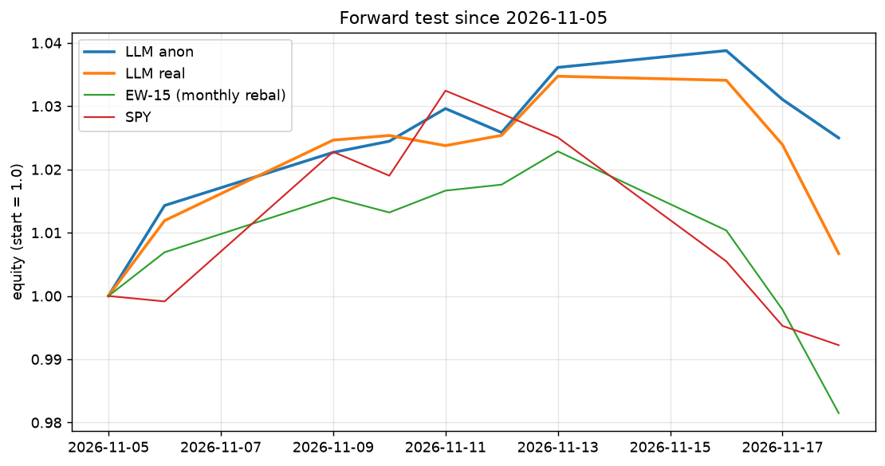

# Forward test (live paper trading)

## Hypothesis (stated before any forward decision existed)

The historical study found that the same model, given real tickers and dates, behaved very differently from
the same model given anonymised prices (2022: +11.9% real vs +1.6% anon; 8/8 vs 0/8 all-cash draws on
2022-06-13), and read that gap as **leakage**: the model remembers the period. After the model's training
cutoff there is nothing to remember. So:

* **H1 (leakage)**: if the historical gap was leakage, the forward real-minus-anon gap should **collapse
  toward zero** (and its sign/size should stop being systematic).
* **H0 (not only leakage)**: if the gap persists forward, the real prompt changes behaviour for reasons
  other than memory of the period (e.g. general sector priors or prompt-token effects), and the leakage
  reading of the historical gap is weakened.

Nothing is tuned: model id, prompt format, weekly cadence, seed and costs are pinned in `forward/config.json`
(same as the historical study). Each decision is appended to `forward/decisions.jsonl` (hash-chained) and committed
before the next US open; `git log --format='%H %cI' -- forward/decisions.jsonl` gives the commit timestamps.
The model's training cutoff is the vendor's to state; this repo does not assume one.

Start: **2026-11-05**; model `gemini-3.5-flash-lite` (provider gemini), cadence weekly, T=0.0, seed 0, costs 10+5 bps/side, rf=0. Hash chain verified over 6 records.

Bars: 2026-11-05 .. 2026-11-16 (8); decisions: 3 anon / 3 real; model id actually served: gemini-3.5-flash-lite.

## Equity since start

| strategy (rf=0) | CAGR | TotalRet | Vol | Sharpe | Sortino | MaxDD | DD_days | Calmar | Turnover | Exposure | WinRate | Trades | Costs | Costs_bps |
|---|---|---|---|---|---|---|---|---|---|---|---|---|---|---|
| LLM anon | 293.2% | 3.9% | 9.4% | 14.57 | 62.59 | -0.4% | 1 | 799.89 | 15.96 | 87.3% | 100.0% | 10 | 1,520 | 15 |
| LLM real | 234.1% | 3.4% | 9.7% | 12.45 | 120.45 | -0.2% | 1 | 1501.45 | 14.29 | 78.6% | 100.0% | 11 | 1,361 | 14 |
| EW-15 (monthly rebal) | 44.9% | 1.0% | 11.2% | 3.36 | 5.04 | -1.2% | 1 | 36.73 | 15.70 | 87.3% |  | 15 | 1,495 | 15 |
| SPY | 21.7% | 0.5% | 21.8% | 0.99 | 1.80 | -2.6% | 3 | 8.31 | 15.72 | 87.4% |  | 1 | 1,497 | 15 |

## Anon vs real gap

Mean daily return difference (real - anon), annualised: **-16.4%** over 7 days.
95% CI withheld until n >= 60 trading days (n = 7); any reading now is noise.

For scale, the historical 2022 gap was +10.3 pp over one year (real +11.9% vs anon +1.6%), same models/prompt.

## Decisions (exposure, number of names held)

| date | anon exp | anon names | real exp | real names | decided at (UTC) |
|---|---|---|---|---|---|
| 2026-11-05 | 1.00 | 5 | 0.90 | 6 | 2026-11-06T02:38:24+00:00 |
| 2026-11-09 | 1.00 | 5 | 0.90 | 6 | 2026-11-10T04:12:54+00:00 |
| 2026-11-16 | 1.00 | 5 | 0.95 | 10 | 2026-11-17T04:40:28+00:00 |

